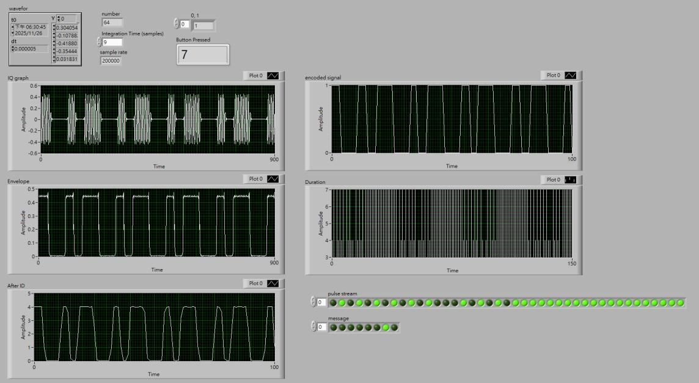
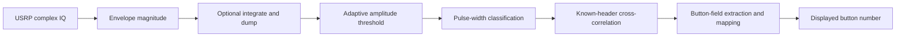
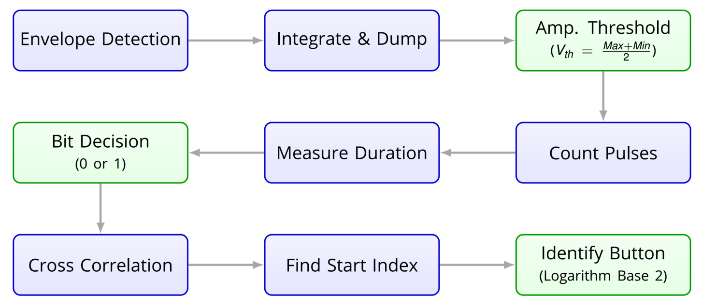

# SDR Key Fob Decoder

**A LabVIEW / USRP receiver project for envelope-based ASK reception and pulse-width button decoding.**

Team project by 洪麒淩 and Hsiang-Yu (Rich) Kung / 孔祥有 for Communication Systems Laboratory. The report does not assign individual modules to each member; the receiver is presented as a team result.

The archived demonstration shows **button 7** alongside intermediate waveforms. It provides a concrete example of decoding in the lab setup; it is not a measured bit-error-rate, range or robustness benchmark.

## Signal-processing chain

| Stage | Design in the report |
|---|---|
| Envelope | Magnitude of the complex IQ samples. |
| Smoothing | Integrate-and-dump operation; the shown button-7 example also decoded without it. |
| Amplitude threshold | Midpoint of the current signal window's maximum and minimum. |
| Pulse-duration threshold | Mean duration of the detected pulses in a frame. |
| Synchronization | Cross-correlation against the known 25-bit synchronization/address header. |
| Button mapping | Base-2 logarithmic mapping for a valid, nonzero one-hot button field. |

## Lesson: adaptive thresholds depend on the data

A mean pulse-width threshold adapts without a fixed manual duration, but a homogeneous symbol sequence can make that average uninformative. The report describes an idle-state case that displayed 9 and a modulo-9 correction to the displayed value. It presents the all-zero / pulse-threshold explanation as a hypothesis; the correction is not evidence that invalid or empty payloads are generally handled correctly.

The report text names one carrier frequency while its receiver screenshot displays another. This overview therefore describes the signal-processing design without claiming a verified carrier configuration. See [evidence and limitations](docs/evidence.md).

## Files

- [Original LabVIEW VI](<archive/student_key fob.vi>)
- [Evidence and limitations](docs/evidence.md)

The VI is preserved unchanged. The project uses LabVIEW and the course's USRP acquisition/transmitter setup; those external components are not included in this source archive.
